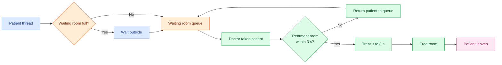

<div align="center">

# Hospital ER Simulation


**A multithreaded emergency room where patients and doctors compete for a limited waiting room and limited treatment rooms, built on a hand-written semaphore.**

[Features](#features) · [How it works](#how-it-works) · [Project structure](#project-structure) · [Usage](#usage) · [Example](#example-output) · [Limitations](#notes-and-limitations) · [Team](#team)

</div>

---

## Features

| | |
|---|---|
| **One thread per actor** | Every patient and every doctor is its own Java thread |
| **Custom Semaphore** | Written from scratch with `synchronized`, `wait` and `notifyAll`, not `java.util.concurrent` |
| **Bounded waiting room** | Patients who arrive when it is full wait outside until a seat opens |
| **Timeout on rooms** | A doctor waits at most 3 seconds for a treatment room, then returns the patient |
| **JavaFX GUI** | Enter the waiting room capacity, doctors and patients, then watch a live log |
| **Clean shutdown** | When all patients are treated, doctors are interrupted and joined |

---

## How it works



1. **Patients arrive** and call `WaitingRoom.enter()`. If there is no free seat, they print a message and block until one opens.
2. **The waiting room** is a bounded buffer guarded by three semaphores: `empty` (free seats), `full` (patients waiting) and `mutualExclusion` (protects the queue).
3. **A doctor takes** the next patient, then tries to acquire one of the **2 treatment rooms** for up to 3000 ms.
4. **If no room is free in time**, the doctor sends the patient back to the waiting room and becomes available again.
5. **If a room is acquired**, the doctor treats the patient for a random 3 to 8 seconds, frees the room, and marks the patient as treated.
6. **The patient wakes up** (`wait` / `notifyAll`) and leaves.
7. **When every patient has left**, `Hospital` interrupts all doctors and waits for them to stop.

<details>
<summary><b>Synchronization details</b></summary>

<br/>

| Resource | Semaphore | Initial value | Purpose |
|---|---|:---:|---|
| Free waiting room seats | `empty` | `capacity` | Blocks patients when the room is full |
| Patients waiting | `full` | `0` | Blocks doctors when nobody is waiting |
| Queue access | `mutualExclusion` | `1` | Only one thread touches the queue at a time |
| Treatment rooms | `treatmentRooms` | `2` | Limits how many patients are treated at once |

The custom `Semaphore` offers four operations:

| Method | Behavior |
|---|---|
| `get()` | Blocks until a unit is available |
| `free()` | Releases a unit and wakes waiting threads |
| `tryGetNow()` | Takes a unit if available, returns `false` immediately otherwise |
| `tryget(timeoutMillis)` | Waits up to the timeout, returns whether a unit was acquired |

Patients are notified through their own monitor: `Patient.run()` waits on `treated`, and `Doctor` calls `patient.treat()`, which sets the flag and calls `notifyAll()`.

</details>

---

## Project structure

| File | Role |
|---|---|
| `Main.java` | Entry point, launches the JavaFX `GUI` |
| `GUI.java` | Input fields, Start button, live log area (redirects `System.out`) |
| `Hospital.java` | Creates the waiting room, rooms, doctors and patients, and runs the simulation |
| `Doctor.java` | Consumer thread: take patient, get room, treat, free room |
| `Patient.java` | Producer thread: arrive, enter waiting room, wait to be treated, leave |
| `WaitingRoom.java` | Bounded buffer built from three semaphores |
| `Semaphore.java` | Custom counting semaphore with timeout support |

---

## Usage

### Requirements

- JDK 11 or newer
- [JavaFX SDK](https://openjfx.io/) matching your JDK

### Compile and run

```bash
# Replace /path/to/javafx-sdk with your JavaFX SDK folder
javac --module-path /path/to/javafx-sdk/lib --add-modules javafx.controls *.java
java  --module-path /path/to/javafx-sdk/lib --add-modules javafx.controls Main
```

Or open the folder in an IDE (IntelliJ, Eclipse, VS Code), add the JavaFX libraries, and run `Main`.

> [!NOTE]
> The entry point is `Main`, not `GUI`. Launching through a separate class avoids the common "JavaFX runtime components are missing" error.

### Inputs

| Field | Example | Notes |
|---|---|---|
| Waiting Room Capacity | `3` | Number of seats, must be a positive integer |
| Number of Doctors | `3` | Number of doctor threads, must be a positive integer |
| Number of Patients | `6` | Number of patient threads, must be a positive integer |

Press **Start Simulation**. The log fills in real time and the button is re-enabled when the simulation completes. The number of treatment rooms is fixed at **2** in `Hospital.java`.

---

## Example output

An illustrative run with capacity `2`, `2` doctors and `4` patients (exact order varies between runs because of thread scheduling):

```text
Patients arriving:
P1 P2 P3 P4
P1 arrived.
P2 arrived.
P1 entered the waiting room.
P2 entered the waiting room.
P3 arrived.
The waiting room is full.
P3 is waiting outside for an available seat.
Doctor 1 is assigned to P1.
Doctor 1 is trying to get a treatment room.
Doctor 1 got a treatment room.
Doctor 1 begins treating P1.
P3 entered the waiting room.
...
Doctor 1 finished treating P1.
Doctor 1 free a treatment room.
Doctor 1 is now available.
P1 left.
...
All patients have been treated.
Simulation completed.
```

---

## Notes and limitations

> [!NOTE]
> These are known design trade-offs, useful to mention in a report or oral discussion.

- **Returned patients lose their place.** A patient sent back after a timeout goes to the back of the queue.
- **A doctor can block while holding a patient.** If a doctor times out and the waiting room is full again, `returnPatient` waits for a free seat. It resolves once another doctor takes a patient.
- **Treatment rooms are hardcoded to 2.** Change the value in `Hospital.java`, or add a GUI field.
- **Doctor threads are not daemons.** Closing the window mid-simulation can leave doctors running. Making them daemon threads or calling `Platform.exit()` and `System.exit(0)` in `stop()` fixes this.
- **Log order is not strict.** "Doctor is now available" prints before the patient's "left" message because `treat()` is called afterwards.
- The simulation is nondeterministic: treatment times are random and thread scheduling differs per run.

---

## Team

<div align="center">

**Malak Alaa** · **Jana Yehia** · **Bilal Mohamed** · **Hassan Sameh**

</div>

---

<div align="center">

Made with a lot of threads

</div>
